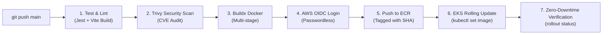

# 🚀 CloudOps E-Commerce Platform
### Enterprise Full-Stack E-Commerce Architecture with Automated DevOps, Kubernetes (AWS EKS), Multi-Stage Docker, Terraform IaC & Prometheus Observability

[](#5-cicd-pipeline-deep-dive)
[](#6-kubernetes-manifests--autoscaling)
[](#4-docker-implementation)
[](#7-terraform-infrastructure-as-code)
[](#8-monitoring--observability-prometheus--grafana)
[](#9-security--compliance)

---

## 📌 Executive Summary

The **CloudOps E-Commerce Platform** is a production-style, resilient full-stack web application and cloud infrastructure project engineered for technical interviews and portfolio demonstration targeting **DevOps Engineer**, **Cloud Architect**, and **Site Reliability Engineer (SRE)** roles.

It couples a modern **React 18 + Three.js + Tailwind CSS** consumer store with an **Express.js / Node.js** micro-service backend, backed by **MongoDB / RDS MySQL**, containerized with multi-stage Docker builds, automated through **GitHub Actions CI/CD**, provisioned across a multi-AZ AWS topology using **Terraform**, orchestrated on **Amazon Elastic Kubernetes Service (EKS)**, and monitored in real time using **Prometheus & Grafana**.

---

## 🏗️ System Architecture

```
                             [ End Users / Web Browsers ]
                                          │
                                          ▼
                      [ Amazon Route 53 (Latency Routing) ]
                                          │
                     ┌────────────────────┴────────────────────┐
                     ▼                                         ▼
         [ Amazon CloudFront CDN ]                 [ AWS Application Load Balancer ]
          (S3 Static Assets OAC)                   (Internet-Facing, Multi-AZ ACM)
                                                               │
     ┌─────────────────────────────────────────────────────────┴─────────────────────────────────────────┐
     │                                                                                                   │
     │  VPC: 10.0.0.0/16                                                                                 │
     │  ┌─────────────────────────────────────────────────────────────────────────────────────────────┐  │
     │  │  AWS EKS Cluster (v1.30) - Private Subnets (us-east-1a, us-east-1b, us-east-1c)             │  │
     │  │                                                                                             │  │
     │  │   [ Kubernetes Ingress ]                                                                    │  │
     │  │             │                                                                               │  │
     │  │             ├─── Path: / ──────► [ Frontend Service (ClusterIP:80) ]                        │  │
     │  │             │                            │                                                  │  │
     │  │             │                            ▼                                                  │  │
     │  │             │                  [ Frontend Pods (3 Replicas) ]                               │  │
     │  │             │                  - Nginx 1.25 Alpine                                          │  │
     │  │             │                  - React 18 SPA + Vite                                        │  │
     │  │             │                  - HPA: 70% CPU Target                                        │  │
     │  │             │                                                                               │  │
     │  │             └─── Path: /api ───► [ Backend Service (ClusterIP:5000) ]                       │  │
     │  │                                          │                                                  │  │
     │  │                                          ▼                                                  │  │
     │  │                                [ Backend Pods (3 Replicas) ]                                │  │
     │  │                                - Node.js 20 Alpine (Non-Root)                               │  │
     │  │                                - Express REST API                                           │  │
     │  │                                - Liveness/Readiness/Startup Probes                          │  │
     │  │                                - HPA: 75% CPU / 80% Memory                                  │  │
     │  │                                          │                                                  │  │
     │  │                ┌─────────────────────────┼─────────────────────────┐                        │  │
     │  │                ▼                         ▼                         ▼                        │  │
     │  │     [ Prometheus Scraper ]     [ AWS Secrets Manager ]     [ Multi-AZ Database ]            │  │
     │  │     - Scrapes /metrics 5s      - DB Passwords, JWT Key     - Amazon RDS MySQL 8.0           │  │
     │  │     - RED Metrics + Alerts     - IRSA Service Account      - or DocumentDB / Mongo          │  │
     │  │                │                                                                            │  │
     │  │                ▼                                                                            │  │
     │  │      [ Grafana Dashboard ]                                                                  │  │
     │  │      - Port 3001 (Real-time)                                                                │  │
     │  └─────────────────────────────────────────────────────────────────────────────────────────────┘  │
     │                                                                                                   │
     └───────────────────────────────────────────────────────────────────────────────────────────────────┘
```

---

## 🛠️ Technology Stack Breakdown

| Tier | Technologies | Highlights |
| :--- | :--- | :--- |
| **Frontend** | React 18, Vite, Tailwind CSS, Three.js, Framer Motion, Lucide Icons | 3D Interactive Hero Canvas, Glassmorphism UI, Dark/Light mode, Responsive |
| **Backend** | Node.js 20, Express.js, `prom-client`, Helmet, CORS, Morgan, bcryptjs, JWT | RESTful API, RED telemetry, K8s L7 probes, graceful termination |
| **Database** | MongoDB / AWS DocumentDB & MySQL 8.0 (Amazon RDS) | Dual-resilience engine: auto-fallback to embedded store for zero-dep runs |
| **Containers** | Docker, Docker Compose, Nginx Alpine, Multi-stage builds | Slim immutable images, non-root user execution, security headers |
| **Cloud (AWS)**| AWS EKS, EC2, ECR, S3, CloudFront, RDS, IAM, Secrets Manager, VPC | Terraform provisioned Multi-AZ infrastructure with least-privilege policies |
| **Kubernetes** | EKS v1.30, HPA v2, Ingress (ALB/Nginx), PodDisruptionBudget, NetPolicy | RollingUpdate strategy, resource limits, anti-affinity, readiness probes |
| **CI/CD** | GitHub Actions Workflows, AWS OIDC (Keyless), Trivy Security Scan | Automated lint, unit test, build, CVE audit, ECR push, EKS rollout |
| **Monitoring** | Prometheus v2.48, Grafana v10.2, Node-Exporter | Automated alert rules, scrape intervals 5s, pre-built visual dashboards |

---

## ⚡ Quick Evaluation Credentials

To immediately evaluate admin features or shopper flows without registration:

| Role | Email | Password | Permissions |
| :--- | :--- | :--- | :--- |
| **DevOps Admin** | `admin@ecommerce.io` | `Admin@123` | Full access to Admin Dashboard, Product Inventory Management, Order Status Updates |
| **Customer Shopper** | `user@ecommerce.io` | `User@123` | Cart operations, Checkout, Order Placement, Review submission, Wishlist |

> **Promo Code**: Apply `DEVOPS20` during checkout for **20% off** your order!

---

## 🌐 Default Port Mappings

| Service | Internal Port | Host / Browser URL | Description |
| :--- | :--- | :--- | :--- |
| **Frontend UI** | 80 | `http://localhost:3000` | E-Commerce Shopping Experience + DevOps Dashboard |
| **Backend API** | 5000 | `http://localhost:5000` | REST API, K8s Probes, and Root Status |
| **Prometheus Metrics**| 5000 | `http://localhost:5000/metrics` | Raw Prometheus text-based scrape endpoint |
| **Prometheus Server** | 9090 | `http://localhost:9090` | Prometheus Web UI, Targets, and Rule Evaluator |
| **Grafana** | 3000 | `http://localhost:3001` | Pre-provisioned SRE Visual Dashboard (`admin` / `admin`) |
| **MongoDB** | 27017 | `localhost:27017` | Local database daemon (when running Docker Compose) |
| **Node Exporter** | 9100 | `http://localhost:9100/metrics` | Host hardware and OS telemetry |

---

## 📦 Local Installation & Setup

### Option 1: One-Command Docker Compose (Recommended)
Spins up the entire microservices stack (Frontend, Backend, MongoDB, Prometheus, Grafana, Node-Exporter) in isolated containers:

```bash
# Clone the repository
git clone https://github.com/your-username/ecommerce-devops-platform.git
cd ecommerce-devops-platform

# Launch the entire environment
docker compose up --build
```
Once healthy:
- Open Store & DevOps Dashboard: **http://localhost:3000**
- Open Prometheus: **http://localhost:9090**
- Open Grafana: **http://localhost:3001** (Login: `admin` / `admin`)

---

### Option 2: Direct Local Node.js Development
If you do not have Docker running, the application includes a **Resilient In-Memory Database Engine** that enables running the full platform natively with zero external dependencies:

#### 1. Start the Backend API:
```bash
cd backend
npm install
npm run dev
```
*Backend initializes on `http://localhost:5000`.*

#### 2. Start the Frontend Single-Page App:
```bash
cd frontend
npm install
npm run dev
```
*Frontend hot-reloads on `http://localhost:3000` with reverse proxy enabled.*

#### 3. Run Automated Tests:
```bash
cd backend
npm test
```

---

## 🐳 Docker Implementation Deep Dive

Both microservices leverage multi-stage Docker builds to keep images lightweight, secure, and production-hardened:

### 1. Backend Dockerfile (`backend/Dockerfile`)
- **Stage 1 (Builder)**: Uses `node:20-alpine`, installs full dependencies, executes automated tests (`npm test`) as a build quality gate, and prunes devDependencies.
- **Stage 2 (Runner)**:
  - Base: `node:20-alpine` (Minimal attack surface ~84MB total size)
  - Enforces **non-root user** (`USER node`)
  - Built-in container health check targeting `http://localhost:5000/health`
  - Handles `SIGTERM` and `SIGINT` signals for graceful HTTP connection draining during Kubernetes rolling updates.

### 2. Frontend Dockerfile (`frontend/Dockerfile`)
- **Stage 1 (Builder)**: Uses `node:20-alpine`, installs npm packages, compiles optimized Vite production bundle into `/app/dist`.
- **Stage 2 (Runner)**:
  - Base: `nginx:1.25-alpine` (~38MB)
  - Custom `nginx.conf` configured with Gzip compression, immutable asset caching, and security headers (`X-Frame-Options`, `X-Content-Type-Options`).
  - Native reverse proxy routing:
    - `/api/` ➡️ `http://backend:5000/api/`
    - `/health` ➡️ `http://backend:5000/health`
    - `/metrics` ➡️ `http://backend:5000/metrics`
    - `/` ➡️ `index.html` (SPA fallback)

---

## 🤖 CI/CD Pipeline Deep Dive (GitHub Actions)

The workflow defined in `.github/workflows/ci-cd.yml` automates the complete DevOps lifecycle:



### Key Security & Reliability Features:
1. **Passwordless AWS Authentication**: Uses **AWS IAM OpenID Connect (OIDC)** with `sts:AssumeRoleWithWebIdentity` to exchange ephemeral GitHub tokens for short-lived AWS credentials. No static `AWS_ACCESS_KEY_ID` or `AWS_SECRET_ACCESS_KEY` secrets are stored in GitHub repository settings.
2. **Container CVE Scanning**: **Trivy** scans built container images for Critical and High vulnerabilities before allowing them to push to Amazon ECR.
3. **Zero-Downtime Rolling Update**: `kubectl rollout status deployment/ecommerce-backend -n ecommerce-prod --timeout=180s` ensures that old pods are only terminated after new pods pass their HTTP readiness probes.

---

## ☁️ Terraform Infrastructure as Code (AWS)

All AWS cloud infrastructure is declaratively defined under `terraform/`:

| File | AWS Resources Provisioned |
| :--- | :--- |
| `main.tf` | Terraform constraints, AWS provider (`~> 5.30`), global resource tags |
| `variables.tf` | Region (`us-east-1`), VPC CIDR (`10.0.0.0/16`), EKS cluster name, DB configs |
| `vpc.tf` | Multi-AZ VPC across 3 AZs, 3 Public Subnets, 3 Private Subnets, IGW, NAT Gateway |
| `security_groups.tf` | Least-privilege rules: ALB SG, EKS Worker Node SG, private RDS SG |
| `ecr.tf` | ECR Repositories for frontend and backend with image scan on push and lifecycle rules |
| `eks.tf` | EKS Cluster v1.30, OIDC Provider (IRSA), Managed Node Group (`desired=3, min=2, max=6`) |
| `ec2.tf` | Alternative standalone EC2 ASG launch template with Docker auto-bootstrap `user_data` |
| `rds.tf` | Multi-AZ MySQL 8.0 RDS with automated backups, private subnet group, KMS encryption |
| `s3.tf` | S3 Media bucket with CloudFront Origin Access Control (OAC) and HTTPS distribution |
| `iam.tf` | GitHub Actions OIDC role with fine-grained ECR and EKS deployment policies |
| `secrets.tf` | AWS Secrets Manager secret storing database credentials and JWT secret key |
| `outputs.tf` | EKS endpoint, ECR URLs, ALB DNS, RDS endpoint, S3 bucket name |

### Provisioning Instructions:
```bash
cd terraform
cp terraform.tfvars.example terraform.tfvars
# Update variables if desired

terraform init
terraform plan
terraform apply -auto-approve
```

---

## ☸️ Kubernetes Manifests & Autoscaling

Production-grade manifests are located in `kubernetes/`:

1. **Namespace (`namespace.yaml`)**: Isolates platform workloads inside `ecommerce-prod`.
2. **ConfigMap & Secret (`configmap.yaml`, `secrets.yaml`)**: Environment variables and credentials separation.
3. **Deployment (`deployment.yaml`)**:
   - 3 Replicas with `RollingUpdate` (`maxSurge: 1, maxUnavailable: 0`)
   - `podAntiAffinity`: Ensures pods are distributed across different nodes/AZs.
   - Resource requests and limits (`requests: 100m CPU, 128Mi RAM` / `limits: 500m CPU, 512Mi RAM`).
   - L7 Health Probes:
     - `startupProbe`: `/health/startup` (allows slow initial boot)
     - `livenessProbe`: `/health/live` (kills hung containers)
     - `readinessProbe`: `/health/ready` (routes traffic only when database is ready)
4. **Service (`service.yaml`)**: ClusterIP services for internal discovery.
5. **Ingress (`ingress.yaml`)**: AWS ALB Ingress Controller rules routing `/` to Frontend, `/api` to Backend, and `/metrics` to Prometheus.
6. **HorizontalPodAutoscaler (`hpa.yaml`)**:
   - Scales backend pods from **3 up to 10** when CPU exceeds 75% or memory exceeds 80%.
   - Scales frontend pods from **3 up to 8** when CPU exceeds 70%.
7. **PodDisruptionBudget (`pdb.yaml`)**: Guarantees a minimum of 2 available pods during node drains, maintenance, and cluster upgrades.
8. **Network Policy (`network-policy.yaml`)**: Zero-trust network rules restricting backend database access to frontend pods and monitoring scrapers.

---

## 📊 Monitoring & Observability (Prometheus & Grafana)

The platform implements Google SRE's **RED Method** (Rate, Errors, Duration):

### 1. Prometheus Metrics Collected (`/metrics`):
- `http_requests_total`: Counter by HTTP method, route, and status code (2xx/4xx/5xx).
- `http_request_duration_seconds`: Histogram tracking latency buckets (p50, p90, p95, p99).
- `http_active_requests`: Real-time gauge of in-flight HTTP requests.
- `ecommerce_orders_total`: Business transaction counter.
- `ecommerce_revenue_total_usd`: Total sales volume gauge.
- `nodejs_resident_memory_bytes`: Memory consumption.

### 2. Prometheus Alert Rules (`monitoring/prometheus/alert.rules.yml`):
- **ServiceDown**: Triggers critical alert if `up == 0` for > 30 seconds.
- **HighHttpErrorRate**: Triggers critical alert if 5xx error rate exceeds 5% of total traffic.
- **HighRequestLatencyP95**: Triggers warning alert if 95th percentile latency exceeds 500ms.
- **HighMemoryUsage**: Triggers alert if process RSS memory exceeds 500MB.

### 3. Grafana Dashboard (`monitoring/grafana/dashboards/ecommerce-devops-dashboard.json`):
- Pre-provisioned visual dashboard with timeseries graphs for RPS, Latency percentiles, HTTP Status Code distribution, and Container resource metrics.

---

## 🔒 Security & Compliance

- **Authentication**: JWT (JSON Web Tokens) with 7-day expiration and password hashing using `bcryptjs` (salt rounds: 10).
- **Role-Based Access Control (RBAC)**: Distinct permissions for `user` vs `admin`.
- **HTTP Hardening**: Helmet security headers, CORS strict domain restriction, rate-limiting ready.
- **Least-Privilege AWS IAM**: Service roles scoped strictly to explicit actions without wildcard permissions.
- **Static Analysis & CVE Auditing**: Automated container image scanning via Trivy.

---

## 🎯 Technical Interview & Defense Q&A

### Q1: How do you guarantee zero downtime during application deployments?
> **Answer**: We combine Kubernetes `RollingUpdate` strategy (`maxSurge: 1, maxUnavailable: 0`) with HTTP readiness probes (`/health/ready`). When a new deployment is triggered, Kubernetes starts a new pod replica. The Application Load Balancer will not route traffic to the new pod until its readiness probe returns HTTP 200. Only once the new pod is healthy will Kubernetes gracefully terminate the old pod, ensuring continuous uptime.

### Q2: Why use GitHub Actions OIDC instead of AWS Access Keys in repository secrets?
> **Answer**: Static AWS Access Keys pose severe security risks (key rotation overhead, potential leaks, no expiration). By utilizing **OpenID Connect (OIDC)** and AWS STS `AssumeRoleWithWebIdentity`, GitHub Actions exchanges a cryptographically signed JWT token for temporary, short-lived AWS credentials scoped strictly to the repository branch and IAM role policies.

### Q3: How are Prometheus metrics gathered without impacting backend response times?
> **Answer**: Metrics collection is implemented via lightweight non-blocking in-memory counters and histograms from `prom-client`. When an HTTP request completes, the `res.on('finish')` event listener observes the duration and increments the counter asynchronously without adding overhead to the active response pipeline.

---

## 📄 License & Attribution

Distributed under the **MIT License**. Created by the DevOps Engineering Team for technical interview evaluation and academic portfolio demonstration.
